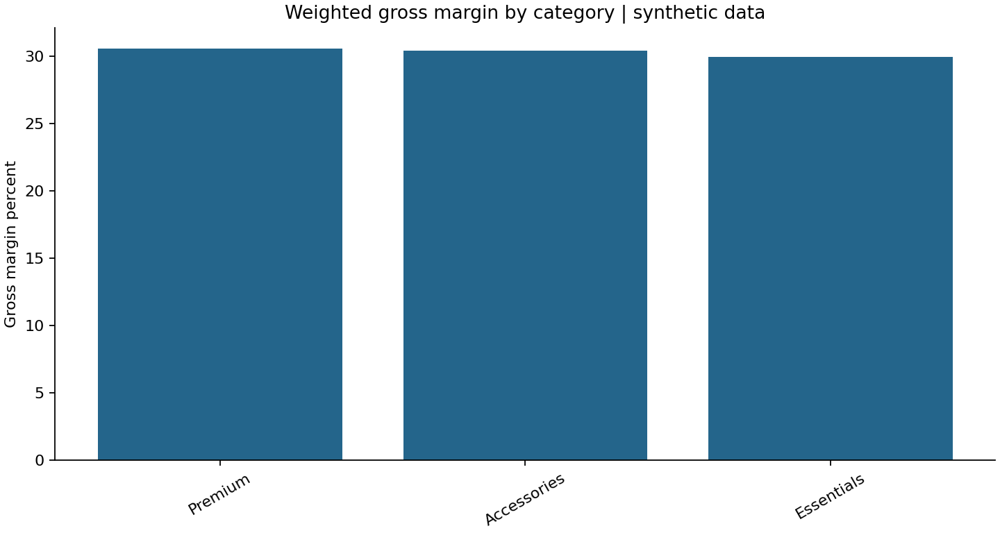

# Commercial Revenue and Margin Analysis

## Business question
Which categories, customer exposures and pricing exceptions deserve a commercial review?

Portfolio demonstration in Sairaj Jadhav’s analytics portfolio. All data is synthetic and is generated
deterministically; this is not TCA data or a professional implementation.

## Data
150 customers, 300 products, 9,001 raw lines and 8,999 valid synthetic transactions.

### Data dictionary
customers: customer_id, region. products: sku, category. transactions: line_id, customer_id, sku, sale_date, units, unit_price_paise, unit_cost_paise.

All amounts with `_paise` suffix are integer hundredths of INR to avoid storing source currency
as floating-point numbers. Dates are ISO `YYYY-MM-DD`. The fixed reporting cutoff is 21 October 2026.
Integer IDs are unique primary keys; relationship fields are enforced as foreign keys.

## Method and KPI definitions
Revenue = units × realised selling price. Gross margin = revenue less recorded product cost. Margin percentage = sum(gross margin) / sum(revenue), not the average of row percentages. LAG compares adjacent observed months; a running sum shows cumulative revenue.

Read [schema.sql](schema.sql) for constraints and [analysis.sql](analysis.sql) for queries.
The SQL is written for SQLite; date functions require adaptation for PostgreSQL or SQL Server.
Inputs are generated and cleaned in [analysis.py](analysis.py), then loaded into the schema.
Where deliberate source defects are introduced, they are quarantined rather than silently repaired.

## Results
Category margins, monthly revenue, ranked customer contribution, below-cost exceptions and margin chart.

Read the [computed findings](findings.md) and [validation record](validation.json).
These files are regenerated from the scripts, not manually invented.



## Reproduce
Install Python 3.10+ and run from this repository directory:

```bash
python -m pip install -r requirements.txt
python analysis.py
python tests.py
```

The script saves CSV inputs, a local SQLite database, query output CSVs, a chart and findings.
It independently computes comparable Pandas metrics and asserts agreement with SQL, checks
reconciliations and tests relevant edge cases. No network access or credentials are needed.

## Limitations and next steps
May and October are partial months. Gross margin is not operating profit, and synthetic trends cannot be generalised to a real business.

Before operational use: agree definitions, reconcile source-system totals, investigate rejected
records, collect missing business context, validate assumptions with users and add incremental loads.
This is a small analytical example, not a production application or a claimed business improvement.

The SQLite database is generated locally and excluded from version control. `tests.py` uses small, hand-checkable fixtures against the actual SQL.
